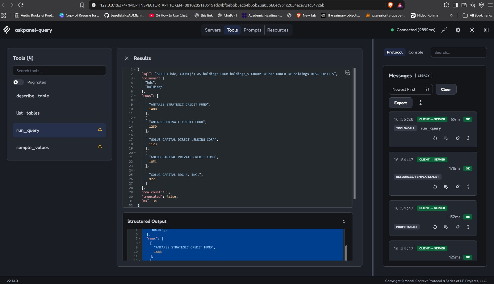
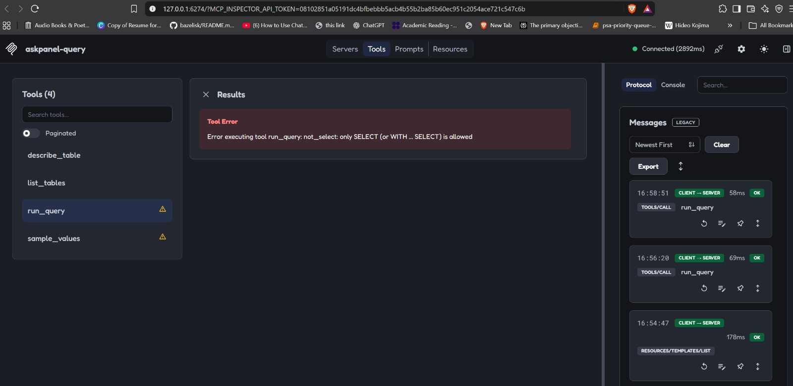

# Ask the Panel (Lab 4B, Project LANTERN Part 4B)

A natural-language query interface over our Lab 3B BDC holdings panel. An analyst types a
question; a LangGraph agent writes ONE SQL query as a Pydantic object; a read-only MCP server
runs it; the answer comes back with the SQL and the rows behind it, or a plain decline when the
data cannot answer.

- Panel: 73 BDC 10-Q filings for period 2026-06-30 (public SEC data), 48,618 holding rows:
  25,257 in the current schedule, 23,361 in the prior fiscal year-end schedule.
- Model: `gemini-3.5-flash-lite`, behind record/replay. Replay (the default) needs no key.

## Setup
Run every command from `cs4b/`. Python 3.12 or later (the pinned NumPy 2.5.4 requires 3.12+; release checks also run on 3.13).
```
pip install -r requirements.txt          # exact pins; requirements.lock is our full frozen set
python tests/run_tests.py                # the kit's 26 tests
python tools/build_db.py                 # data/panel.sqlite from the panel params.yaml selects + our view
pytest -q tests/                         # 64: the kit's 26 + ours (12 contract, 16 server, 10 agent)
python agent/run.py --mode replay        # answer questions/questions.yaml from outputs/cache
PYTHONPATH=src python -m askpanel.check  # Windows: set PYTHONPATH=src && python -m askpanel.check
streamlit run app/streamlit_app.py       # the interface (replay mode by default)
```
Record mode only (never needed to grade): put `GEMINI_API_KEY=...` in `cs4b/.env` (gitignored),
then `python agent/run.py --mode record`. Two replays are byte-identical:
`python agent/run.py --mode replay --verify`.

The MCP Inspector: `mcp dev services/mcp/server.py` (needs Node.js), then call each tool once.

## Architecture
```
 Streamlit app (app/streamlit_app.py)             agent/run.py (batch, the ten questions)
          |                                                |
          +----------------------+-------------------------+
                                 v
   LangGraph agent (agent/graph.py): StateGraph, InMemorySaver checkpointer (one thread per conversation)
      load_schema -> generate -> check --ok--> execute --ok--> summarize
                        ^          |   \--decline--------------^
                        +--repair--+------repair---+        (capped at 3 model calls)
          |                  |                 |
          |     Gemini behind ReplayClient     Pydantic contract (agent/contract.py):
          |     (agent/model.py; outputs/cache)  SQLQuery = exactly one of sql | decline,
          |                                      sql through gate.static_check + cross_join rule
          v
   MCP client (agent/mcp_client.py): synchronous calls over one SDK v2 Client session
          |  MCP protocol (in memory)
          v
   MCP server (services/mcp/server.py): exactly 4 READ tools
      list_tables | describe_table | sample_values | run_query      -> ledger event per call/refusal
          |
          v
   gate (src/askpanel/gate.py): one statement, SELECT/WITH only, authorizer, row cap 200, 5 s timeout
          |
          v
   SQLite, read-only (gate.connect_ro: mode=ro + authorizer): filings, holdings, holdings_v
```
Rules that hold by construction:
- Nothing in `agent/` or `app/` imports `sqlite3` or opens the database; the self-check verifies it.
- The server opens the database with `gate.connect_ro` and runs every query through `gate.run_query`.
  The catalog is closed (`REGISTRY` literal, all READ); every tool has a Pydantic output model
  and the MCP read-only annotation.
- Every tool call and every refusal is a ledger event (`logs/server_ledger.jsonl`, gitignored),
  holding hashes of the SQL rather than its text.

## What is where
| File | Part | What it does |
|---|---|---|
| `sql/holdings_v.sql` | 0 | One row per current holding, BDC name joined on adsh, the 16 contract columns, `price`, `is_debt` |
| `tools/prepare_real_panel.py` | 0 | Copies our cs3b panel; clears principal on the 46 current rows with principal but no fair value (see failures.md, data note) |
| `agent/contract.py` | 1 | `SchemaCatalog`, `QueryRequest`, `SQLQuery`, `QueryResult`, `validate_query` |
| `services/mcp/server.py` | 2 | The four READ tools, panel-specific column descriptions, ledger |
| `agent/mcp_client.py` | 2 | `PanelClient`: blocking tool calls for the agent and app |
| `agent/model.py` | 3 | Gemini behind `askpanel.llm.ReplayClient`; prompt rules; token, cost and latency per call |
| `agent/graph.py` | 3 | The StateGraph; `load_schema` adds exact BDC names and investment types via `sample_values`; `check` uses `validate_query` |
| `agent/run.py` | 3 | `--mode record/replay`, `--verify`; follow-ups continue the thread they follow |
| `app/streamlit_app.py` | 4 | Answer, SQL, rows, cost, model calls, trace, conversation, "New conversation" |
| `questions/questions.yaml` | 5 | Our ten questions |
| `outputs/questions/`, `outputs/cache/` | 5 | Saved answers and the replay cache (committed) |
| `outputs/runs/v1/`, `outputs/runs/v2/` | 6 | Earlier recordings kept as evidence for failures.md |
| `outputs/economics.md`, `outputs/failures.md` | 6 | Unit economics; the failure log |
| `tests/test_contract.py`, `tests/test_server.py`, `tests/test_agent.py` | 1-3 | Refusals, closed catalog, repair, budget, follow-ups, identical replays |

## Results
Final recording (v3, `outputs/questions/`), replayable from `outputs/cache/` with no key; two
replays are byte-identical. Every answer was checked against an independent query of ours.

| id | category | answer (from the trace) |
|---|---|---|
| q01 | lookup | Blackstone Secured Lending Fund's top 5: Snoopy Bidco $342.8M (price 94.00), Guidehouse $302.6M (96.75), JSS Holdings $294.6M (100.00), Auctane $277.3M (98.50), Cambium Learning $262.0M (93.00) |
| q02 | lookup | 15 Golub Capital Private Credit Fund debt holdings with PIK above 5% (top: Inhance Parent One stop 3, 20%) |
| q03 | follow_up (q02) | their combined fair value: $106,150,000 |
| q04 | aggregation | Antares Strategic Credit Fund: DEBT 1,326 ($4.40B), EQUITY 92 ($171.4M), UNKNOWN 70 ($38.8M) |
| q05 | aggregation | panel fair value by type: DEBT 76.68%, UNKNOWN 21.80%, EQUITY 1.52%, OTHER 0.006% |
| q06 | cross_bdc | largest BDCs: Apollo Debt Solutions $25.37B, Goldman Sachs Private Credit $18.19B, Blackstone Secured Lending $13.36B, ... |
| q07 | cross_bdc | highest PIK share of debt holdings: Fidus 28.7% (33 of 115), TriplePoint Private Venture 27.3%, GS Private Middle Market II 21.7%, ... |
| q08 | over_time | Apollo Debt Solutions: 815 to 834 holdings (+19), $24.52B to $25.37B (+$851.6M) |
| q09 | over_time | most holdings added: Audax Credit BDC +217, Golub Capital Private Credit Fund +159, Golub Capital BDC 4 +157, ... |
| q10 | decline | declined: a dividend forecast is not in the panel |

- Cost: $0.000907 per question at list price ($0.009072 for ten), $0 actual (free tier);
  1.0 model call per question. Full table and assumptions: `outputs/economics.md`.
- Failures: five real failures across our v1 and v2 recordings (a LIKE that merged two
  funds, a misleading `is_debt` description, a change never computed, and two failures our
  own fixes caused), each fixed in the system and confirmed in v3: `outputs/failures.md`.

Self-check (`PYTHONPATH=src python -m askpanel.check`): 12/12.

## MCP Inspector
`mcp dev services/mcp/server.py`, connected to `askpanel-query` with its four tools.

A SELECT through `run_query`: five BDCs by holding count, as structured output
(`row_count` 5, `truncated` false).



A write refused by the server: `DELETE` through `run_query` returns a tool error with the
gate's code, `not_select: only SELECT (or WITH ... SELECT) is allowed`, and the server records
a `policy_block` ledger event.



## Notes
- Fixture first: every Part was built and tested on the kit fixture (`data.use_real: false`)
  before we switched to the real panel. The tests still build their own fixture database.
- Repair edge: Gemini needed no repairs on our final ten questions (each took one call).
  The repair edge is shown in `tests/test_agent.py::test_repair_on_the_real_panel`: the
  server refuses `no such column`, and the second attempt answers.
- Public SEC data only; every person in the scenario is fictional.
