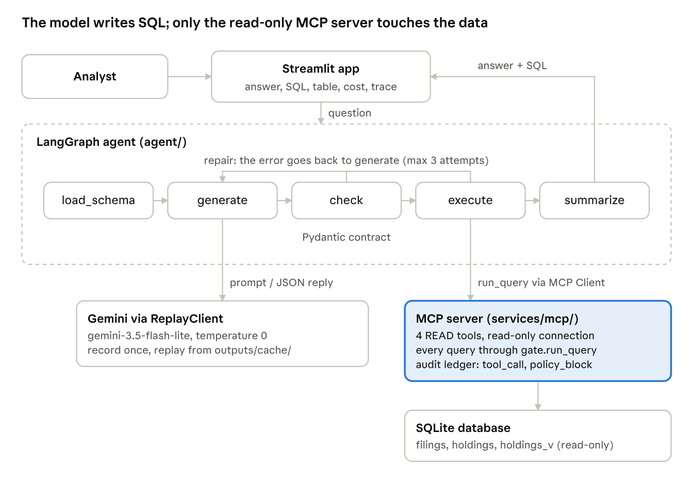

summary: Build Ask the Panel, a natural-language query interface over a BDC holdings panel with Pydantic, an MCP server and LangGraph
id: ask-the-panel
categories: AI, Data Engineering
tags: mcp, langgraph, pydantic, sqlite, streamlit, gemini
status: Published
authors: DAMG 7245 Team 2
Feedback Link: https://github.com/BigDataIA-Fall-26-Team-2/DAMG-7245-Project-Lantern-Case-Study-Lab3B-Team-2/issues

# Ask the Panel: Lab 4B

## Overview
Duration: 5:00

In this codelab you build **Ask the Panel**. An analyst types a question about BDC holdings in plain English, a LangGraph agent writes one SQL query as a validated Pydantic object, a read-only MCP server runs it, and the answer comes back with the SQL behind it.

The finished system answers our ten questions on the real panel 10 of 10 correctly, at $0.0009 per question, and replays with no API key.



### What you will build
- A SQLite database from the Lab 3B panel (73 BDC 10-Qs for 2026-06-30, current and prior schedules) and a view, `holdings_v`, designed for the model
- A Pydantic contract that accepts only one safe SELECT or a decline
- An MCP server with four READ-only tools, a read-only connection and an audit ledger
- A five-node LangGraph agent with a repair edge, a budget guard, conversation memory and record/replay
- A Streamlit app, ten recorded questions, a unit-economics table and a failure log

### What you will learn
- Why the model never touches the database, and how the server enforces it
- How to turn model output into a typed object with rules
- How to make an LLM system reproducible and free to grade
- How to find real failures, fix them in the system, and catch failures your own fixes cause

### Prerequisites
- conda and Python 3.12 (3.11 or later works)
- The Lab 3B real panel in `cs3b/data/real/panel_2p.parquet`
- A Gemini API key, needed only to record; replay needs nothing

### Rules that hold throughout
| Rule | Why |
| --- | --- |
| Nothing in `agent/` or `app/` imports sqlite3 or opens the database | All data access goes through one guarded door |
| All four MCP tools are READ | The model can never change data |
| Never commit an API key or `.env`; replay is the default | Keys leak; graders have no key |
| Build on the fixture first, then the real panel | Debug on small, known data |
| Never invent results | Every number traces to a file in `outputs/` |

## Set up the environment
Duration: 10:00

Notebook: `notebooks/00_setup.ipynb`. At the end of this step the kit's 26 tests pass and the self-check prints your to-do list.

1. Create the environment and install the pinned libraries:

```bash
git checkout feat/lab4b
conda create -n lab4b python=3.12 -y
conda activate lab4b
cd cs4b
pip install -r requirements.txt
```

2. Make sure `.env` is in `.gitignore`, then put your key in `cs4b/.env` (never committed):

```bash
echo GEMINI_API_KEY=your-key-here > .env
```

3. Run the kit's tests and the self-check:

```bash
python tests/run_tests.py                 # 26/26
PYTHONPATH=src python -m askpanel.check  # a list of what is missing
```

| Path | What goes there | Step |
| --- | --- | --- |
| `sql/holdings_v.sql` | the view the model reads | 3 |
| `agent/contract.py` | Pydantic models and `validate_query` | 4 |
| `services/mcp/server.py`, `tests/test_server.py` | the MCP server and its tests | 5 |
| `agent/model.py`, `graph.py`, `mcp_client.py`, `run.py` | the agent | 6 |
| `app/streamlit_app.py`, `questions/questions.yaml` | app and questions | 7 |
| `outputs/failures.md`, `outputs/economics.md` | results | 8, 9 |

## Build the view the model reads
Duration: 15:00

Notebook: `notebooks/32_view.ipynb` (Lab 32B, Part 0).

The panel becomes two tables: `filings` (one row per 10-Q) and `holdings` (one row per holding). Every filing carries two schedules, `current` and `prior`, so a model querying `holdings` directly counts every holding twice. The model reads one view instead.

1. Write `sql/holdings_v.sql`:

```sql
DROP VIEW IF EXISTS holdings_v;
CREATE VIEW holdings_v AS
SELECT
    h.adsh, f.name AS bdc, f.form, f.period,
    h.identifier, h.investment_type, h.industry,
    h.fair_value, h.cost, h.principal,
    CASE WHEN h.principal > 0
         THEN ROUND(100.0 * h.fair_value / h.principal, 4)
         ELSE NULL END AS price,
    h.pik_rate, h.interest_rate, h.spread, h.maturity,
    CASE WHEN h.principal > 0 THEN 1 ELSE 0 END AS is_debt
FROM holdings AS h
JOIN filings  AS f ON f.adsh = h.adsh
WHERE h.period_role = 'current';
```

The join is on `adsh` (the filing ID), the `WHERE` keeps only the current schedule, and `price` is NULL rather than a guess when there is no principal.

2. Check it on the fixture (`data.use_real: false`), then on the real panel:

```bash
python tools/build_db.py               # holdings_v: meets the contract
python tools/prepare_real_panel.py     # copy the real panel
# set data.use_real: true in params.yaml
python tools/build_db.py
```

Negative
: 46 current rows in the real panel have a principal but no fair value, so no price can be computed and the view check fails. `tools/prepare_real_panel.py` clears principal on exactly those 46 rows and prints the count. Nothing is invented, and fair value totals per filing are unchanged.

## Write the contract
Duration: 15:00

Notebook: `notebooks/33_contract.ipynb` (Lab 33B, Part 1).

The model's reply is an object with rules, not a string. The kit's `gate.static_check` refuses anything that is not one read-only statement:

| SQL | Result |
| --- | --- |
| `SELECT bdc FROM holdings_v` | ok |
| `DELETE FROM holdings` | `not_select` |
| `SELECT 1; DROP TABLE holdings` | `multiple_statements` |
| `SELECT * FROM sqlite_master` | `not_authorized` |

1. In `agent/contract.py`, define `SchemaCatalog`, `QueryRequest`, `SQLQuery` and `QueryResult` as Pydantic v2 models.

2. Put the rules on `SQLQuery`:

```python
class SQLQuery(BaseModel):
    sql: Optional[str] = None
    decline: Optional[str] = None
    explanation: str = ""

    @field_validator("sql")
    @classmethod
    def gated(cls, v):
        if v is None:
            return None
        try:
            v = gate.static_check(v)
        except gate.GateError as e:
            raise PydanticCustomError(e.code, "{detail}", {"detail": e.detail}) from None
        if cross_join(v):
            raise PydanticCustomError("cross_join", "{detail}", {...})
        return v

    @model_validator(mode="after")
    def exactly_one(self):
        if (self.sql is None) == (self.decline is None):
            raise PydanticCustomError("invalid", "give exactly one of sql or decline")
        return self
```

3. Write `validate_query(data)`, which returns `(SQLQuery, None)` or `(None, {"code": ..., "detail": ...})` with the gate's code, so the repair step can tell the model exactly what went wrong.

Positive
: Our own rule, `cross_join`, refuses `ON 1=1`, `ON TRUE` and `CROSS JOIN`. That SQL is valid and read-only, so the gate passes it, but over this panel it pairs every filing with every other one. It caused failure 5 (Step 8).

`tests/test_contract.py` has 12 tests.

## Build the MCP query server
Duration: 20:00

Notebook: `notebooks/34_server.ipynb` (Lab 34B, Part 2).

The agent reaches data only through `services/mcp/server.py`.

1. Declare the closed catalog as a literal:

```python
REGISTRY = {
    "list_tables": "READ",
    "describe_table": "READ",
    "sample_values": "READ",
    "run_query": "READ",
}
```

| Tool | Returns | Why the model needs it |
| --- | --- | --- |
| `list_tables` | queryable tables and views | to know what exists |
| `describe_table` | each column with its meaning | to pick the right column |
| `sample_values` | distinct values of a column | to spell BDC names exactly |
| `run_query` | columns, rows, row count, truncated | to run ONE SELECT |

2. Open the database read-only and route every query through the gate:

```python
@mcp.tool(annotations=READ)
def run_query(sql: str) -> QueryResult:
    """Run ONE read-only SELECT (READ)."""
    with _State.lock:
        try:
            r = gate.run_query(_con(), sql, max_rows=MAX_ROWS, timeout_s=TIMEOUT_S)
        except gate.GateError as e:
            _refuse("run_query", e.code, e.detail, sql_hash=_h(sql or ""))
        _State.ledger.record("tool_call", tool="run_query", sql_hash=_h(r["sql"]),
                             rows=r["row_count"])
        return QueryResult(**r)
```

Return a Pydantic model so the result arrives as `structured_content`. Raise `ToolError` so the client sees the gate's code. Each refusal writes a `policy_block` event to `logs/server_ledger.jsonl`.

3. Test over the protocol with the in-memory `Client(server.mcp)`:

```bash
python tools/build_db.py && pytest -q tests/test_server.py     # 16 passed
```

The tests check that the catalog is closed and that a SELECT works. They also check that `INSERT`, `DROP`, `ATTACH`, `PRAGMA`, `sqlite_master` and a second statement are all refused, and the database is unchanged.

4. Call each tool in the MCP Inspector: `mcp dev services/mcp/server.py`. Screenshots are in `docs/inspector.jpeg` and `docs/inspector_refusal.jpeg`.

## Wire the agent
Duration: 30:00

Notebook: `notebooks/35_agent.ipynb` (Lab 35B, Part 3).

| Node | What it does | Routes to |
| --- | --- | --- |
| `load_schema` | tables, columns, exact BDC names and rules | `generate` |
| `generate` | asks the model for `{sql}` or `{decline}` | `check` |
| `check` | runs `validate_query` | `execute`, `summarize` (decline) or `generate` (repair) |
| `execute` | calls `run_query` on the MCP server | `summarize` or `generate` (repair) |
| `summarize` | turns rows into the answer | end |

1. `agent/mcp_client.py` holds one SDK v2 `Client` session in a single long-lived task and exposes four plain functions. Nothing in `agent/` imports sqlite3.

2. `agent/graph.py` builds the graph:

```python
g = StateGraph(AskState)
g.add_node("load_schema", schema_with_values(n["load_schema"], tools))
g.add_node("generate", n["generate"])
g.add_node("check", contract_check(clock))
g.add_node("execute", n["execute"])
g.add_node("summarize", n["summarize"])
g.add_edge(START, "load_schema")
g.add_edge("load_schema", "generate")
g.add_edge("generate", "check")
g.add_conditional_edges("check", route_after_check,
    {"execute": "execute", "generate": "generate", "summarize": "summarize"})
g.add_conditional_edges("execute", route_after_execute,
    {"generate": "generate", "summarize": "summarize"})
g.add_edge("summarize", END)
app = g.compile(checkpointer=InMemorySaver())
```

The repair edge stops at 3 attempts, and the budget guard stops at $0.10 or 30,000 tokens per question. The checkpointer keeps one thread per conversation, so a follow-up sees the earlier question and its SQL.

3. `agent/model.py` calls `gemini-3.5-flash-lite` (temperature 0, JSON output) behind the kit's `ReplayClient`:

| Mode | What happens | Needs |
| --- | --- | --- |
| `record` | calls Gemini, saves each response under the SHA-256 of the request | `GEMINI_API_KEY` |
| `replay` (default) | reads the saved response; a miss is an error | nothing |

Positive
: The prompt rules and exact values live inside the schema, which is part of the request, so changing a rule can never replay a stale answer.

4. `agent/run.py` answers the questions:

```bash
python agent/run.py --mode record              # once, with the key
python agent/run.py --mode replay --verify     # two replays byte-identical: True
```

5. Prove the repair edge on the real panel: `pytest -q tests/test_agent.py -k repair`. The server refuses `no such column: holding_type`, and the second attempt returns Antares's DEBT 1,326, EQUITY 92, UNKNOWN 70.

## Build the app and ask ten questions
Duration: 25:00

Notebook: `notebooks/36_app_and_questions.ipynb` (Lab 36B, Parts 4 and 5).

1. `app/streamlit_app.py` caches the MCP client and graph with `st.cache_resource`. It shows the answer, the SQL, the results table, the cost, the model calls and the trace. Replay is the default.

```bash
streamlit run app/streamlit_app.py
```

2. `questions/questions.yaml` covers lookup 2, aggregation 2, cross_bdc 2, over_time 2, follow_up 1 and decline 1.

| id | Category | Answer (final recording) |
| --- | --- | --- |
| q01 | lookup | Blackstone Secured Lending top 5: Snoopy Bidco $342.8M (94.00), ... |
| q02 | lookup | 15 Golub Capital Private Credit Fund debt holdings with PIK above 5% |
| q03 | follow_up | their combined fair value: $106,150,000 |
| q04 | aggregation | Antares: DEBT 1,326 ($4.40B), EQUITY 92, UNKNOWN 70 |
| q05 | aggregation | DEBT 76.68%, UNKNOWN 21.80%, EQUITY 1.52%, OTHER 0.006% |
| q06 | cross_bdc | Apollo Debt Solutions $25.37B, Goldman Sachs Private Credit $18.19B, ... |
| q07 | cross_bdc | Fidus 28.7% (33 of 115), TriplePoint Private Venture 27.3%, ... |
| q08 | over_time | Apollo: 815 to 834 holdings (+19), $24.52B to $25.37B |
| q09 | over_time | Audax Credit BDC +217, Golub Capital Private Credit +159, ... |
| q10 | decline | declined: a forecast is not in the panel |

## Find failures and fix them in the system
Duration: 20:00

We recorded three times, scoring 7/10, then 7/10, then 10/10. Every answer was checked against an independent query, and every fix went into the system, never into the question text.

| # | Run | Question | What went wrong | What fixed it |
| --- | --- | --- | --- | --- |
| 1 | v1 | q04 | `LIKE` matched a sibling fund: DEBT 1,622 instead of 1,326 | Exact BDC names in the schema; `bdc =`, never LIKE |
| 2 | v1 | q05 | Split on `is_debt`: 92.30% debt | Panel-specific descriptions; split by `investment_type` |
| 3 | v1 | q08 | Never computed the change | Rule: return prior, current and change |
| 4 | v2 | q02, q03 | Caused by fix 2: 7 rows instead of 15 | One debt definition: `DEBT OR (UNKNOWN AND is_debt = 1)` |
| 5 | v2 | q08 | Caused by fix 3: `ON 1=1` took Stellus's figures | `cross_join` validator plus a keyed one-pass pattern |

Negative
: The worst failures pass every gate. Failures 1 and 5 were valid, read-only SQL with wrong numbers, and only an independent check caught them.

Full evidence, with request keys, is in `outputs/failures.md`.

## Work out the unit economics
Duration: 10:00

| Line | Value |
| --- | --- |
| Cost per completed task | $0.000907 per question at $0.30 / $2.50 per million tokens; $0 actual (free tier) |
| Latency | median 7.0 s live; all ten replayed in 3.98 s |
| Human time saved | 3.33 analyst hours ($400) at 20 min and $120/h per question |
| Quality | 10 of 10 in v3, against 7 of 10 in v1 and v2 |
| Cost of failure | about $12 of analyst time per wrong answer, roughly 13,000 times the model cost |

Assumptions are in `outputs/economics.md`.

## Verify and submit
Duration: 10:00

Run the grader's commands on a clean clone with no API key:

```bash
pip install -r requirements.txt && python tests/run_tests.py
python tools/build_db.py && pytest -q tests/test_server.py
python agent/run.py --mode replay && PYTHONPATH=src python -m askpanel.check   # 12/12
streamlit run app/streamlit_app.py
```

Then commit, push and tag:

```bash
git push origin feat/lab4b
git tag cs4b-submission
git push origin cs4b-submission
```

## Congratulations
Duration: 2:00

You built a question-answering system in which the model writes SQL but never touches the data. It has a view designed for the model, a Pydantic contract, a read-only MCP server with an audit trail, and a LangGraph agent with repair, budget and memory. All of it replays for free.

### Further reading
- [Model Context Protocol](https://modelcontextprotocol.io)
- [LangGraph documentation](https://langchain-ai.github.io/langgraph/)
- [Pydantic documentation](https://docs.pydantic.dev)
